# ADMINISTRATIVE ASSISTANT USER MANUAL

**Integrated Communication System (ICS) · Northeast Luzon Mission**

This guide covers the Administrative Assistant pages and actions available in ICS, from signing in through logging out. Screenshots use numbered red callouts. Personal information in the participant screenshot is masked. Actions and data can differ by account, department, event, and permissions; use the controls shown for your account.

### Quick start

- Sign in with your assigned email and password to open the Administrative Assistant dashboard.
- Use **Pastors** to create, edit, and assign pastor accounts.
- Use **Events** to find, review, and manage event registration and participant status.
- Use **Reports** to monitor quarter-by-quarter report progress, review data, and approve eligible reports.
- Use your profile menu to update your own account information.
- Select **Log out** when you finish, especially on shared or public devices.

## 1. SIGN IN AND NAVIGATE

### Sign in

1. Open the ICS web address provided by your organization.
2. Enter your assigned email and password.
3. Select **Remember me** only on a trusted personal device.
4. Select **Login** and confirm that the account shown is **Administrative Assistant**.
5. If you cannot sign in, check your credentials and contact your administrator if the problem continues. Never send your password to support.

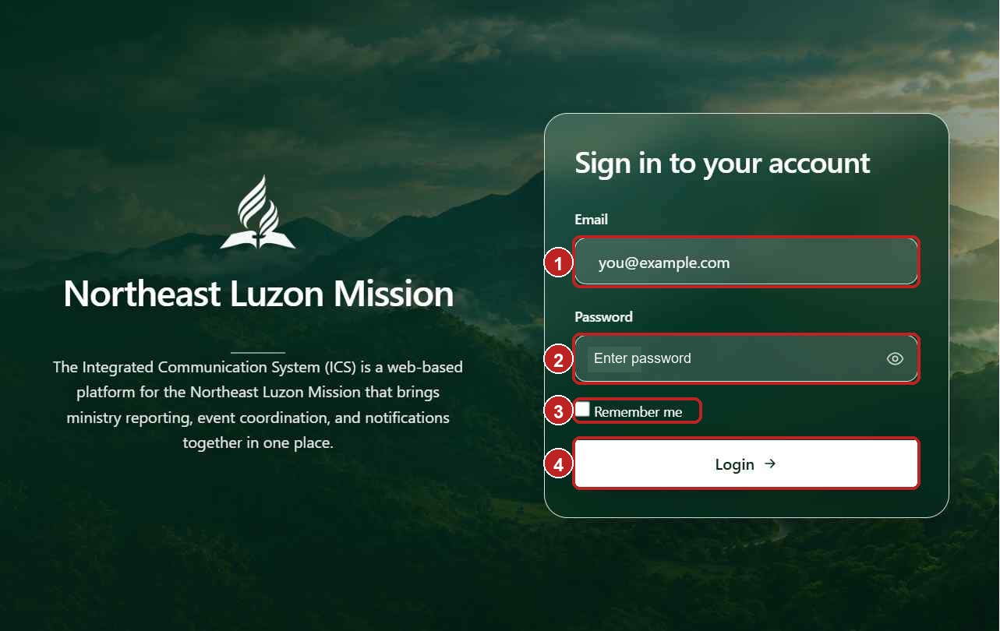

**Figure 1. Sign in.** 1. Enter your assigned email. 2. Enter your password. 3. Optionally select **Remember me** on a trusted device. 4. Select **Login**.

### Use the navigation

- **Pastors** opens pastor accounts and district assignments.
- **Events** opens the event calendar and event list.
- **Reports** opens quarterly report monitoring, templates, summaries, and any personal-record reports available to your account.
- Select your profile area at the bottom of the sidebar to open **Your profile**.
- Select **Log out** to end your session.
- On a small screen, use the menu button to show or hide the sidebar.

## 2. PASTOR ACCOUNTS AND DISTRICT ASSIGNMENTS

### Find and open a pastor

1. Select **Pastors**.
2. Search by pastor name or email.
3. Filter by district and account status (**All statuses**, **Active**, or **Inactive**).
4. Use **Previous** and **Next** to browse the results.
5. Select a pastor row to open the account. The list shows the pastor, district, email, and status.
6. If the list is empty, clear the search and filters and check that the correct status is selected.

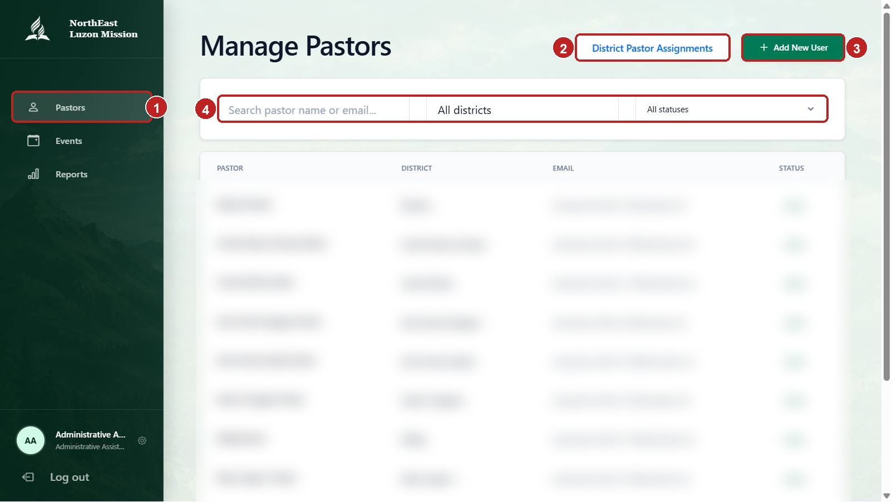

**Figure 2. Pastors.** 1. Open **Pastors**. 2. Open **District Pastor Assignments**. 3. Select **Add New User**. 4. Search or filter the pastor list.

### Create a pastor account

1. On the Pastors page, select **Add New User**.
2. Complete the required first name, last name, birthdate, gender, email, and password fields. Middle name and suffix are optional.
3. Select an available district.
4. Check the entries and submit the form.
5. Wait for the success message. If validation errors appear, correct the highlighted fields and submit again.

The system does not allow an active district to have more than one active pastor. If a district is already occupied, use the assignment workflow below rather than creating a duplicate account.

### Edit an account and change its status

1. Find the pastor. To locate an inactive account, set the status filter to **Inactive**.
2. Open the pastor row and select **Edit profile**.
3. Update the permitted personal, contact, gender, birthdate, or district fields.
4. To keep the current password, leave **New password** blank. Enter a new password only when a password change is intended.
5. Select **Save changes**. Select **Cancel** to discard unsaved edits.
6. To restore an inactive account, select **Activate account**. To disable an active account, select **Deactivate account**.
7. Check the displayed account status after the action completes.

Deactivation is not permanent deletion: the account and its records remain in ICS, but the account cannot sign in while inactive. Verify the account before changing its status.

### Assign or transfer a pastor to a district

1. Select **District Pastor Assignments** from the Pastors page.
2. Use **Filter by district** to find a district. The page shows vacant districts and active pastor counts; select **Clear filter** to show all districts again.
3. Select the district card whose assignment you want to manage.
4. Choose the pastor from the available list.
5. Review the current and proposed assignments in the confirmation or transfer panel.
6. Confirm only after checking the pastor and destination district.

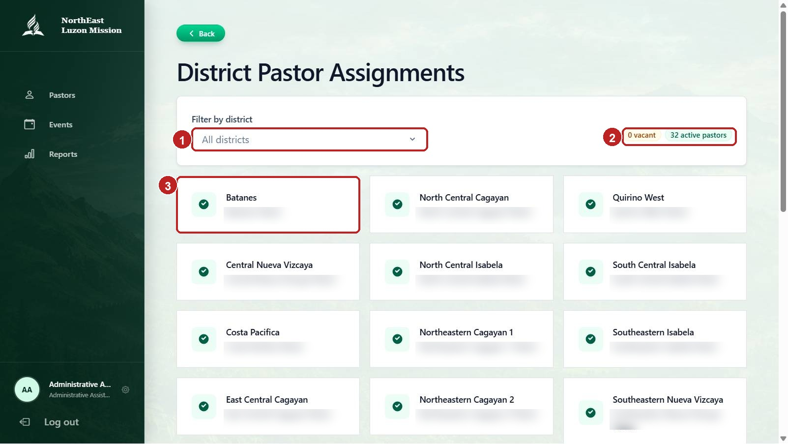

**Figure 3. District Pastor Assignments.** 1. Filter districts. 2. Review vacant and active counts. 3. Select a district card to manage its assignment.

An assignment change can leave the pastor's previous district vacant. Read any replacement or transfer warning before confirming.

## 3. EVENTS

### Find an event

1. Select **Events**.
2. Use the calendar arrows to move between months. Select a month or a calendar day with events to narrow the list. Select **Go to today** when it appears to return to the current month.
3. Search by event name.
4. Filter by **Upcoming**, **Ongoing**, **Completed**, or **All**.
5. Select an event card or **View details** to open its overview.
6. If you cannot find an event, clear the search and day filter or choose another month or status.

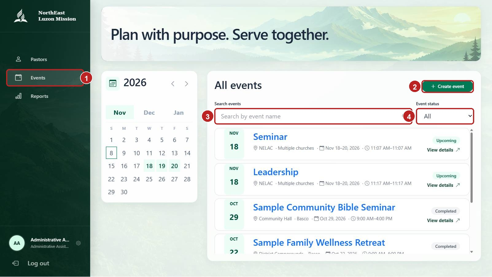

**Figure 4. Events.** 1. Open **Events**. 2. Select **Create event** when available. 3. Search by event name. 4. Filter by status. Use the calendar to select a date.

### View event details

1. Open an event from the list.
2. Review the title, status, reporting period, date and time, location, host church, coverage, and announcement.
3. In **Selected particulars**, expand or collapse a program group to review the particular items included in the event.
4. In **Participants**, review the listed, confirmed, and pending counts.
5. Select **View participants** to open the full participant directory.
6. Select **Back** to return to the event list.

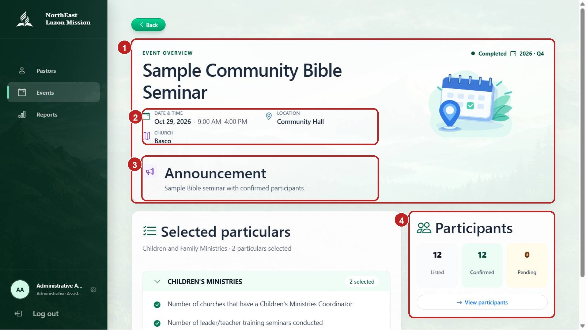

**Figure 5. Event overview.** 1. Event title, status, and reporting period. 2. Schedule, location, host church, and coverage. 3. Announcement. 4. Participant counts and **View participants**.

### View and filter event participants

1. From the event overview, select **View participants**.
2. Use the **Church** filter to show all churches or one church when church choices are available.
3. Search by participant name or gender.
4. Use **Confirmation status** to show all statuses, confirmed participants, or pending participants.
5. Review the participant rows. Available fields include participant name, age, gender, and status.
6. Use the page controls at the bottom of the list to move between pages. The list shows up to 10 participants per page.
7. If a **Confirm** or **Set pending** action appears and your account is authorized, use it to update that participant's confirmation status. Wait for the update to finish and verify the status. If the action is not shown, the list is view-only for your account.
8. Select **Back** to return to the event overview.

Filters return to the first page when changed. Participant data refreshes automatically while the page is open. If loading fails, use **Try again** and check your connection.

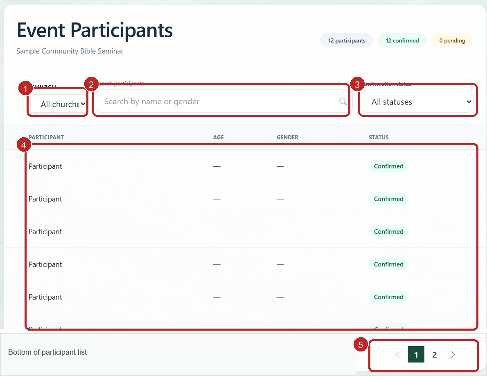

**Figure 6. View participants.** 1. Choose a church. 2. Search participants. 3. Filter by confirmation status. 4. Review the participant list and status. 5. Use the page controls at the bottom.

### Create an event

The event form has two steps. The exact department and coverage choices depend on your account.

**Step 1 — Select department and particulars**

1. Select **Create event** on the Events page.
2. If a department selector is shown, choose the department for the event. An assigned account may have its department selected automatically.
3. Open the relevant program groups and select each particular the event will cover.
4. Review the selected-particulars summary and select **Next**.
5. Correct any highlighted required selection before proceeding.

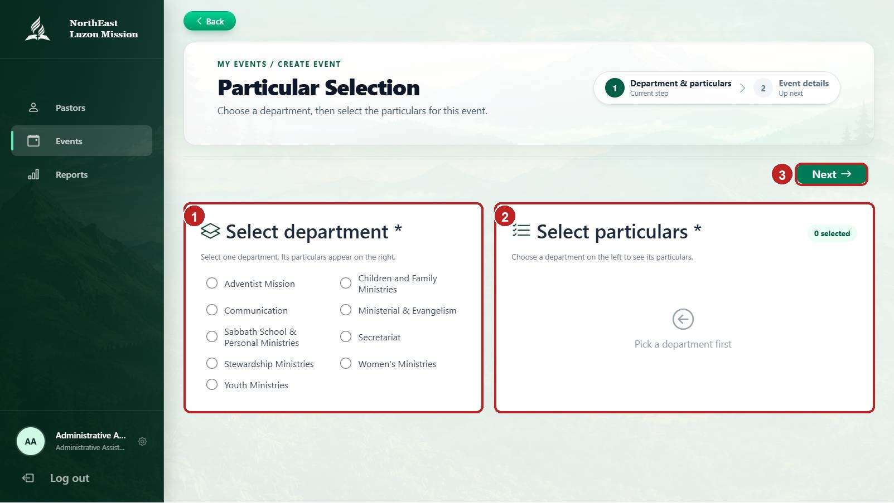

**Figure 7. Choose particulars.** 1. Select the department if prompted. 2. Choose the relevant particulars. 3. Review the selection and select **Next**.

**Step 2 — Enter event details and coverage**

1. Enter the required **Event title** and **Location**.
2. Enter the required start and end dates and times. Times are in Philippine Standard Time (UTC+8); the end date cannot be before the start date.
3. Add an announcement or event notes if needed.
4. Select a required **Host church**. Use the church search field if the list is long.
5. Select the districts included in the event's coverage. Use the available selection or search controls to choose the intended districts.
6. Review the department, selected particulars, schedule, host church, and coverage summary.
7. Select **Create event** and wait for confirmation.

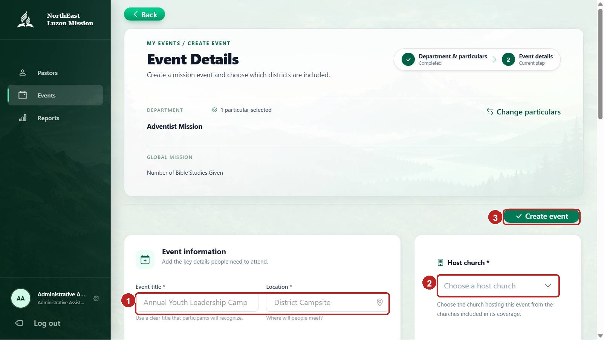

**Figure 8. Enter event information.** Complete the title and location, choose the host church, and submit after reviewing the form.

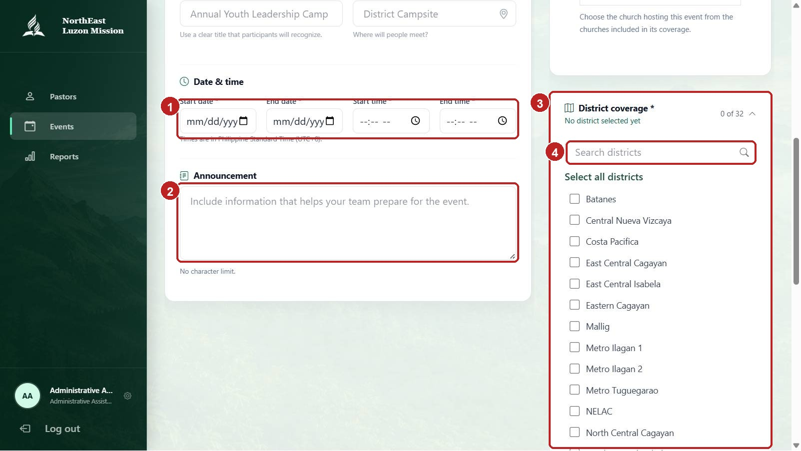

**Figure 9. Set schedule and coverage.** Enter the dates and times, add an announcement if needed, and select the intended district coverage.

If ICS identifies missing information or a scheduling overlap, follow the error message, correct the form, and submit again.

### Edit or delete an event

1. Open the event overview.
2. Select **Edit event** when it is displayed.
3. Update the particulars or event details, reviewing all required fields and coverage.
4. Select **Update event** and wait for confirmation.
5. To delete, select **Delete event** and read the confirmation message.
6. Select **Yes, delete** only if you intend to permanently remove the correct event. Select **Keep event** to cancel.

Edit and delete controls depend on the event's permissions. Deleting an event also removes its participant list and cannot be undone.

### Generate and share a participant registration link

1. Open the event overview and look for **Participant registration link**.
2. If the link has not been generated and **Generate church registration link** is available, select it and wait for the link to appear.
3. Select **Copy registration link**.
4. Share the link only with the intended participants. Registrations through this link are associated with the church shown by ICS.

The registration-link controls appear only when permitted for the event and your account.

## 4. REPORTS

### Monitor quarterly reports

1. Select **Reports**.
2. Choose a reporting year.
3. Search for a district, then select a district row to expand its churches.
4. Expand a church to show the department report statuses.
5. Review the Q1–Q4 status indicators. Select a quarter status to open its report details.
6. Use **Report summary** for totals when available. Use **New report** to create a report template.
7. Use **Retry** if a district or report list fails to load.

An assistant assigned to a department generally sees that department's reports. An assistant without a department assignment may have mission-wide department access. ICS restricts data according to the signed-in account.

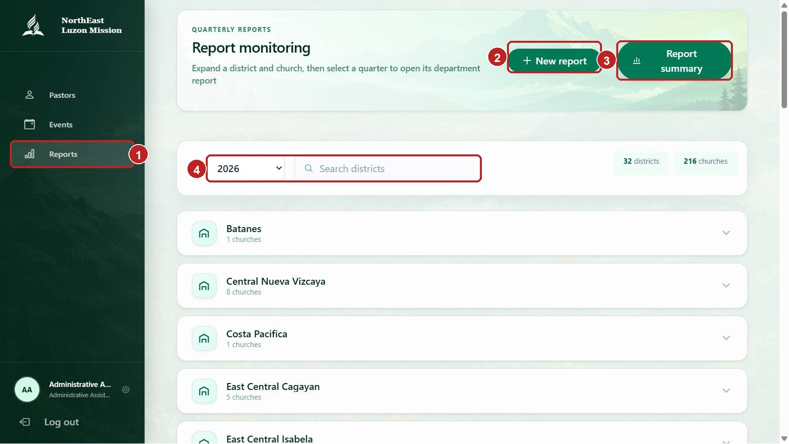

**Figure 10. Report monitoring.** 1. Open **Reports**. 2. Select **New report** when available. 3. Open **Report summary**. 4. Choose a reporting year or search for a district.

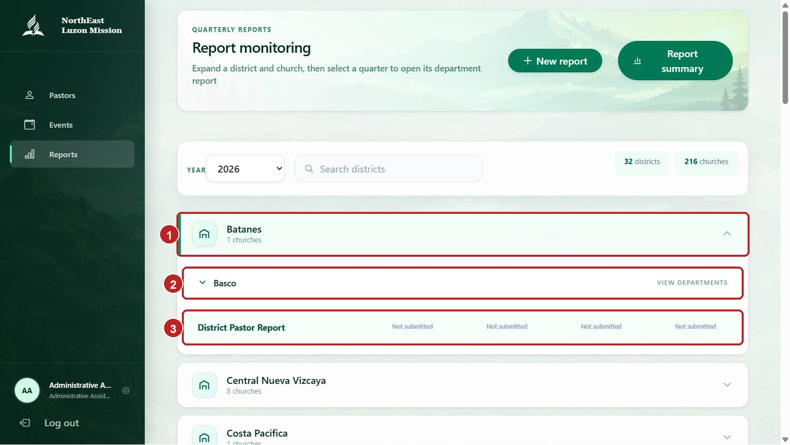

**Figure 11. Open a church report.** Expand a district and church, review the quarter statuses, then select the relevant quarter to open its report.

### Review a quarterly report and comments

1. Open the required district, church, department, and quarter.
2. Confirm the reporting year, quarter, church, and department shown on the page.
3. Select a quarter or **Annual** view to change the reporting period when available.
4. Expand report sections to review each particular and its submitted value. Assistant report values are read-only.
5. Select **Open comments** to read the conversation for the report. If comments are enabled and the report is not approved, enter a message and send it.
6. Use **Export / Print** when available. Check the report period and scope before saving or sharing the preview.
7. Return to the monitoring page with **Back**.

Approved reports are locked and their comment threads are closed. If a submitted value needs correction, contact the pastor responsible for the report.

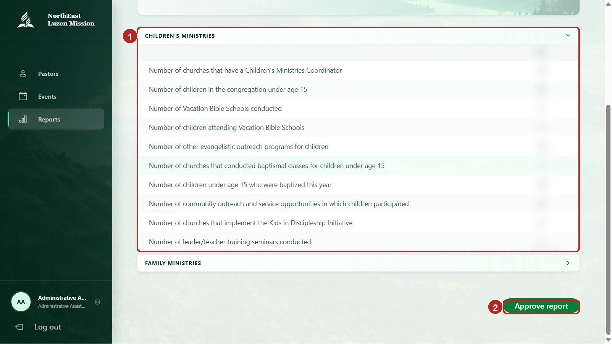

**Figure 12. Review and approve a report.** Review the section and values. The approval action appears only when the report is eligible and your account can approve it.

### Approve an eligible report

Regular Administrative Assistants can approve department reports; Head Assistants cannot.

1. Open the report after the district pastor has endorsed it.
2. Check the reporting year, quarter, department, church, reported values, and comments.
3. Confirm that the previous quarter has already been approved.
4. Select **Approve report** and wait for the status to change to **Approved**.

Do not approve a report that is incomplete or needs correction. Approval locks the report and closes its comments. If the approval action is missing or disabled, the report may not yet be endorsed or the preceding quarter may still need approval.

### View and export the report summary

1. Select **Report summary** from the Reports page.
2. Choose the reporting year and, when offered, the department.
3. Review the summary for the selected scope and year.
4. Select **Export / Print** to open the preview.
5. In the preview, choose **Export CSV**, **Export Excel (.xlsx)**, or **Print** as needed. Close the preview when finished.

Export options can vary with the selected report and account. Check the year and department before exporting, and handle report files as confidential records.

### Create a report template

1. Select **New report** from the Reports page.
2. Select the department if prompted.
3. Enter the program or report name.
4. Add at least one section and provide its name.
5. Add the particular/item names that the report should collect.
6. Check that required names are complete and not duplicated within the same level.
7. Review the template and select **Create report**.

A template defines the fields for future reports; it does not enter a church's quarterly values. The template's department and editing options depend on your account.

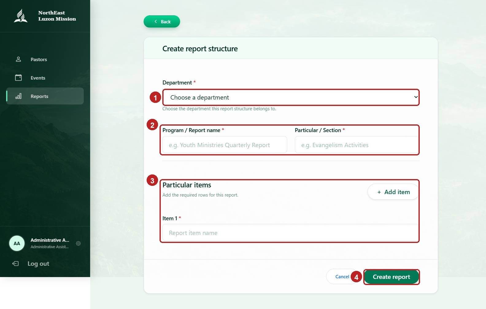

**Figure 13. Create a report template.** Select the department, enter the report and section names, add report items, and save.

### View baptism or death records

These pages appear only when your department and permissions include the relevant personal-record reports. Assistant access is read-only.

1. Open the available **Baptism Record** or **Death Record** report from the report workflow.
2. Select the reporting year and quarter.
3. Search or browse the records. Use **Export / Print** only when needed and authorized.
4. Contact the pastor or authorized administrator to add, correct, or remove a record.

Personal records contain confidential information. Do not copy or share records outside the authorized purpose. If a district or record is unavailable, contact your administrator rather than trying to change your access scope.

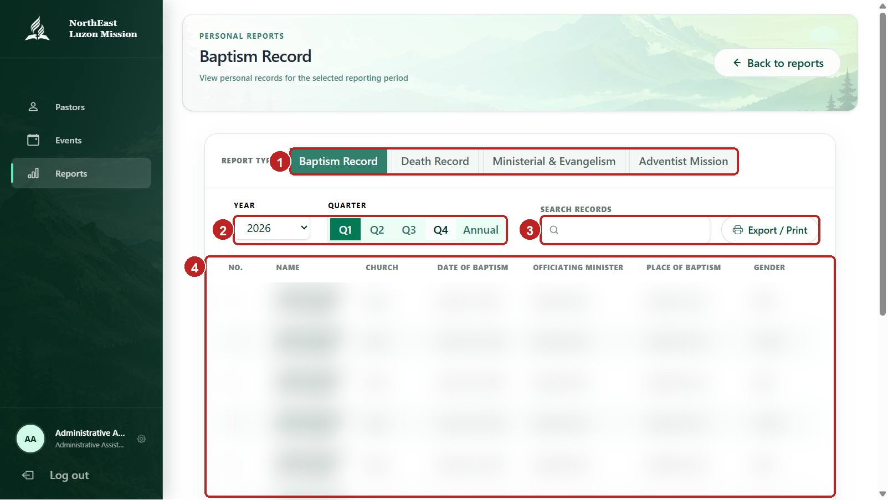

**Figure 14. Personal records.** Select the record type, year, and quarter, then search or export only when authorized. Personal details are obscured.

## 5. YOUR PROFILE

1. Select your profile area at the bottom of the sidebar.
2. Review your personal details and organization assignment.
3. Select **Edit profile** to update your editable personal information.
4. Update the required first name, last name, email, birthdate, and gender fields. Middle name and suffix are optional.
5. To change your photo, select **Upload photo** or **Change photo** and choose a JPG, PNG, or WebP file no larger than 2 MB.
6. Select **Save changes** and wait for the success message. Select **Cancel** to discard unsaved edits.

Your department and church or district assignment are managed by an administrator. Contact your administrator if an assignment is incorrect.

## 6. LOG OUT AND PROTECT INFORMATION

1. Select **Log out** when you finish, especially on a shared device.
2. Do not share your password or leave ICS signed in on a public computer.
3. Use **Remember me** only on a device you control.
4. Treat participant information, personal records, and report data as confidential. Do not share screenshots or exports containing private information with unauthorized people.
5. Contact your administrator promptly if you believe someone else accessed your account.

## 7. ROLE AND PERMISSION NOTES

The **Head Assistant** is a separate role. Both Assistant roles may see the Pastors menu and report tools, but some actions differ:

| Area | Administrative Assistant | Head Assistant |
|---|---|---|
| Pastor accounts | Account and assignment actions appear when allowed. | Account and assignment actions appear when allowed. |
| Events | May create events. Edit, delete, participant confirmation, and registration-link actions depend on event permissions. | Cannot create events. Other event actions appear only when that event grants the required permission. |
| Reports | Can approve eligible, endorsed reports. Access to reports and personal records follows department scope. | Cannot approve reports. Has broader department monitoring, with some personal-record departments unavailable. |
| Report templates and summary | Available from the Assistant Reports page, subject to department scope. | Available from the Assistant Reports page, subject to department scope. |
| Profile | Can edit personal information; organization assignments are administrator-managed. | Can edit personal information; organization assignments are administrator-managed. |

If a control described in this guide is missing or disabled, follow the permissions shown by ICS. Do not use another person's account to perform a restricted action.

## 8. TROUBLESHOOTING

- **Cannot sign in:** Check the email and password. If repeated attempts temporarily block access, wait and try again. Contact your administrator if the problem continues.
- **Cannot create a pastor account:** Check required fields and confirm that the selected district does not already have an active pastor.
- **Cannot assign a pastor:** Check the selected district and pastor, then read the transfer or replacement confirmation carefully.
- **Cannot find a pastor or event:** Clear the search and filters, check account status or event status, and try another district or month.
- **Cannot edit, delete, or manage event participants:** The action may not be enabled for that event or your role. Contact the event organizer or administrator.
- **Cannot see a report or personal record:** Check the year, quarter, church, and department. Availability is restricted by role and department assignment.
- **Cannot approve a report:** Confirm that the district pastor endorsed it and the preceding quarter is approved.
- **A page fails to load or an action reports an error:** Check your connection, select **Try again** or **Retry** when shown, and sign in again if your session expired. If the issue remains, report the page, action, approximate time, and exact error message to your support contact.

Never include your password when reporting a problem.
