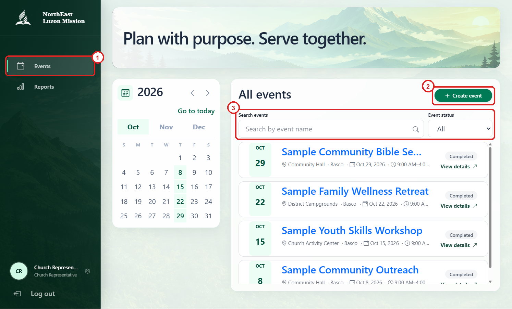
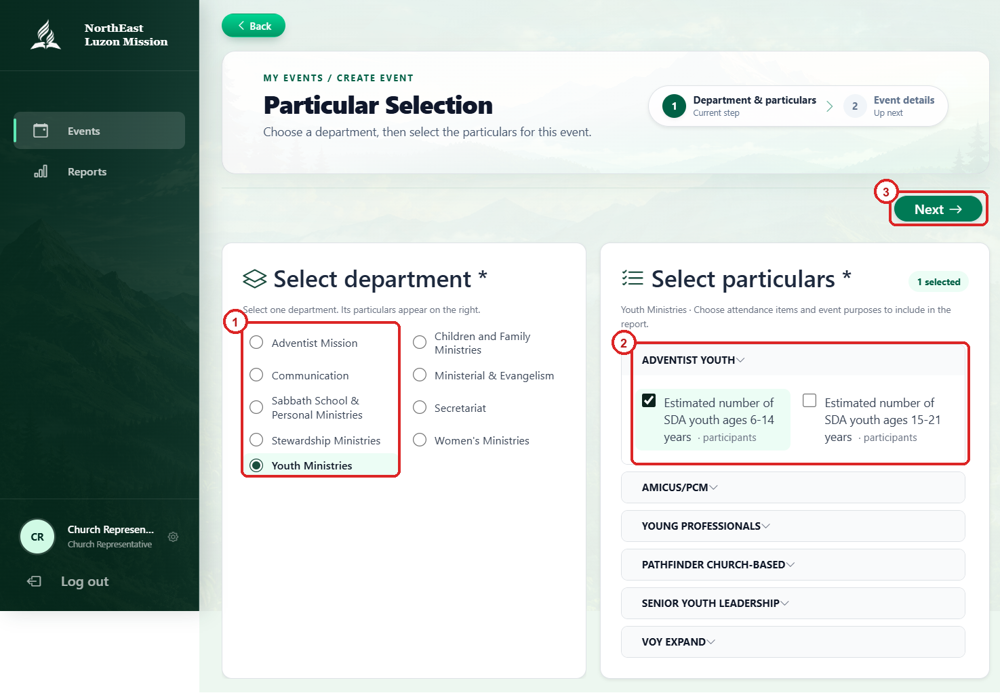
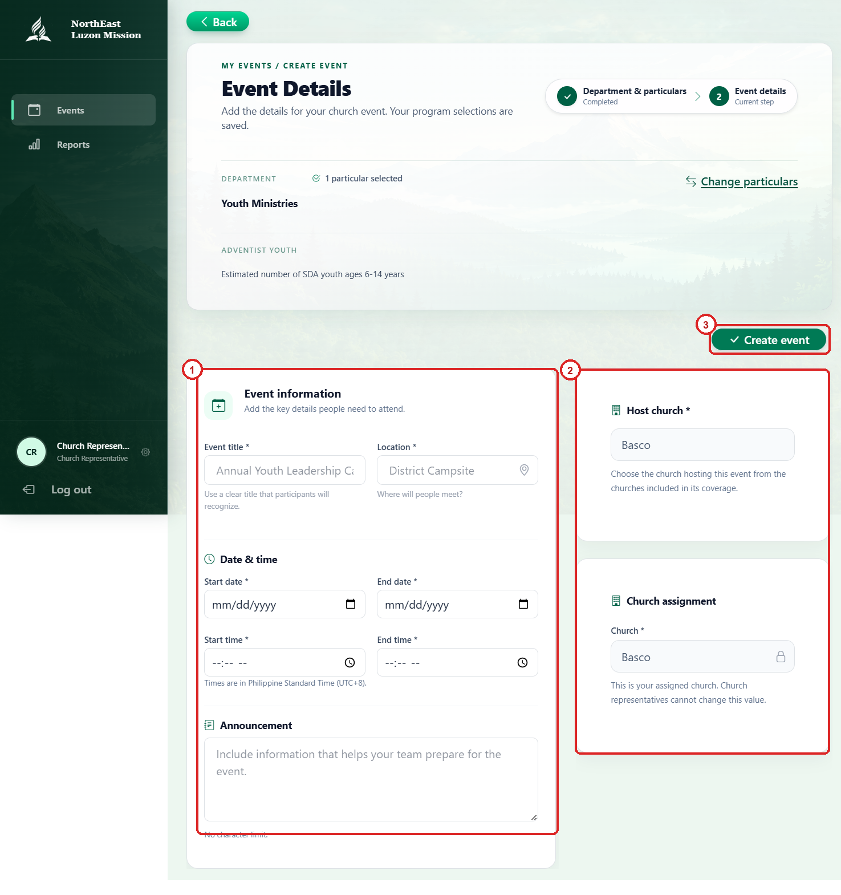
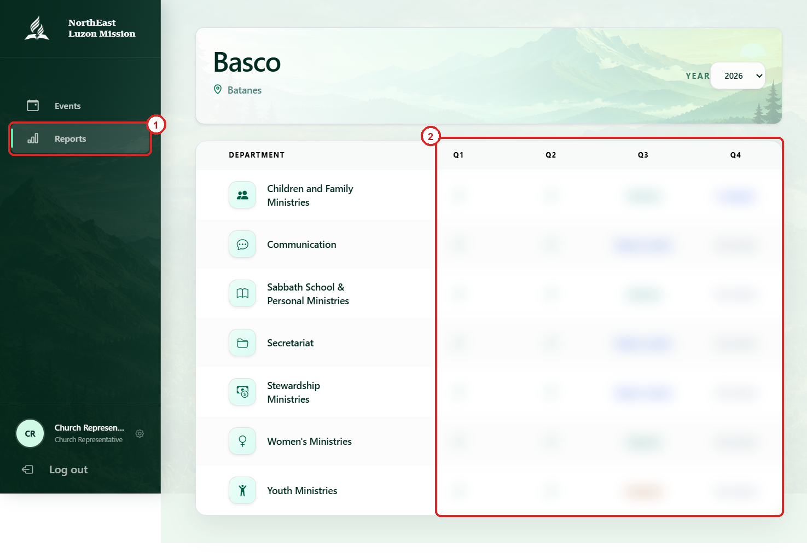
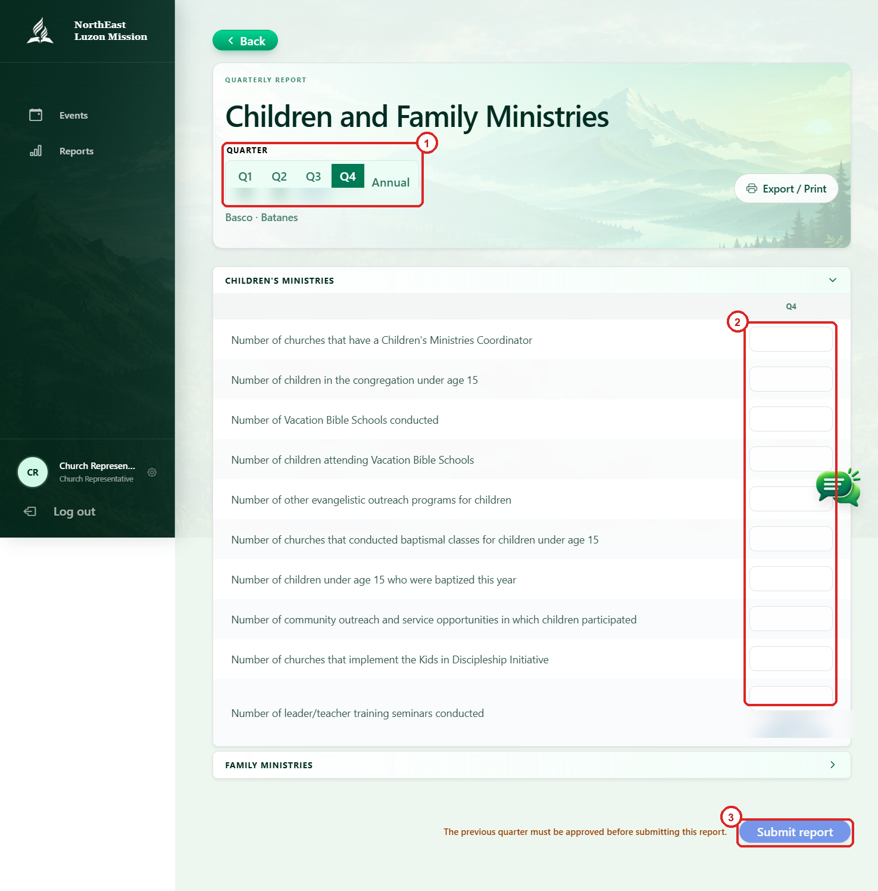

# CHURCH REPRESENTATIVE USER MANUAL

**Integrated Communication System (ICS)**  
**Northeast Luzon Mission**  
**User Manual**

## I. INTRODUCTION

The Integrated Communication System (ICS) is used by church representatives to coordinate church events and participants, complete department reports, and maintain account information. Your account is assigned to a church; the information and actions available to you are limited to that assignment.

This manual explains where to click and how to complete the main representative tasks. Menu labels may change slightly as the system is updated. Screenshots are from the live ICS interface. Red numbered outlines identify the actions described below. Example report values and statuses are obscured for privacy.

## II. HOME PAGE

### A. HOW TO NAVIGATE EACH MENU

1. **Events Menu:** Select **Events** to view, search, filter, create, and manage events for your church.
2. **Reports Menu:** Select **Reports** to open department reports, enter quarterly data, and submit reports for review.
3. **Account Menu:** Select your name or profile area at the bottom of the sidebar to view or edit your personal details.
4. **Logout:** Select **Log out** to securely exit ICS and return to the sign-in page.

On a smaller screen, select the menu button to open or close the sidebar.

**Figure 1. Home page navigation.** 1. Open the **Events** menu. 2. Select **Create event**. 3. Search for an event or filter the event list by status.

### B. HOW TO SIGN IN

1. Open the ICS web address provided by your church or mission administrator.
2. Enter your account email and password on the **Sign in to your account** page.
3. Select **Remember me** only if you are using a trusted personal device.
4. Select **Login**.
5. Confirm that the sidebar identifies your role as **Church Representative**.

## III. EVENTS MENU

### A. HOW TO VIEW AND FIND EVENTS

1. Select **Events** from the sidebar.
2. Browse the calendar. Use the arrows to change month, or select a month or highlighted day to filter events.
3. Enter an event name in **Search events**.
4. Select **Event status** to display upcoming, ongoing, completed, or all events.
5. Select an event card or **View details** to open the event.

If no events appear, check the selected month, date, status, and search text. Clear a selected day or adjust the filters to see more results. Sample events are labeled in the interface.

### B. HOW TO CREATE AN EVENT

1. From the Events page, select **Create event**.
2. Under **Department & particulars**, select the department that applies to the event.
3. Expand the relevant program groups and select the particulars to include in event reporting. Review the selection summary.
4. Select **Next** to continue to event details.

**Figure 2. Select the event particulars.** 1. Choose a department. 2. Select the particulars that apply to the event. 3. Select **Next**. The screenshot shows one example particular; select the items appropriate for your event.

5. Enter the **Event title** and **Location**.
6. Enter the **Start date**, **End date**, **Start time**, and **End time**. Times are in Philippine Standard Time (UTC+8).
7. Add any helpful information in **Announcement**.
8. Review the host church and church assignment. The assigned church is set by the system and cannot be changed by a church representative.
9. Select **Create event** and wait for confirmation.

**Figure 3. Complete the event details.** 1. Enter the event information. 2. Review the host church and assigned church. 3. Select **Create event** after completing the required fields. This example form is blank and has not been submitted.

Fields marked with an asterisk (*) are required. If the form displays an error, correct the highlighted field before trying again.

### C. HOW TO EDIT OR DELETE AN EVENT

1. Select an event from the Events list to open its details.
2. Select **Edit event** to change its details.
3. Review the information and select **Update event** to save changes.
4. To remove an event, select **Delete event** and confirm only if you intend to delete it.

Only manage events that belong to your church and that you are authorized to manage. If an event cannot be edited or deleted, contact your district pastor or system administrator.

### D. HOW TO VIEW PARTICIPANTS AND SHARE A REGISTRATION LINK

1. Open the event details.
2. Select **View participants** to see registrations. Use participant search and the church filter, when available, to find a person.
3. Find **Participant registration link** on the event details page.
4. If there is no link yet, select **Generate church registration link**.
5. Select **Copy registration link** and share it with the intended participants using an appropriate channel.

Registrations made through the church link are assigned to your church and the event report. Share the link only with people who should register for the event.

## IV. REPORTS MENU

### A. HOW TO OPEN A DEPARTMENT REPORT

1. Select **Reports** from the sidebar.
2. Select the reporting year, if needed.
3. Find the department to report.
4. Select the department or the relevant Q1, Q2, Q3, or Q4 status to open its report.
5. Select the quarter to review or edit. Select **Annual** for a read-only summary of the year.

The departments and reporting periods available depend on the data configured for your account. Contact your district pastor if an expected department or quarter is missing.

**Figure 4. Department report overview.** 1. Open **Reports**. 2. Select the department and reporting quarter from the grid.

### B. HOW TO ENTER AND SAVE REPORT VALUES

1. Check the selected department, year, and quarter before entering data.
2. Enter or update values in the applicable particular fields.
3. For stewardship reports, enter monthly figures in the month columns where shown and review the displayed totals.
4. Watch the save indicator:
   - **Unsaved changes…** means edits are waiting to be saved.
   - **Saving…** means the system is saving the edits.
   - **All changes saved** confirms the save completed.
   - **Auto-save failed** means the latest change may not have been saved; check your connection and try again.
5. Wait for the save confirmation before leaving the page or changing periods.

Annual reports are read-only. Approved quarters are locked. Enter accurate report data according to your church's reporting procedure.

**Figure 5. Quarterly report entry.** 1. Choose a quarter or **Annual**. 2. Enter the report values for the selected quarter. 3. Select **Submit report** after reviewing the data. In this example, submission is disabled because the previous quarter must be approved first.

### C. HOW TO SUBMIT A QUARTER

1. Review the selected quarter and all entered values for accuracy.
2. Select **Submit report**. If the report was previously submitted and returned for changes, the button may read **Resubmit report**.
3. Confirm that the report status changes to **Submitted**.
4. Follow up with your district pastor if endorsement is needed.

Reports move through the review process: **Submitted → Endorsed → Approved**. The church representative submits the report; district and mission roles perform the subsequent reviews. If the page says that the previous quarter must be approved first, wait for that approval before submitting the next quarter.

If you need to correct a submitted quarter, use a reopen action only if it is available and the district has not endorsed the report. Once endorsed or approved, contact your district pastor about corrections.

### D. HOW TO DISCUSS, EXPORT, OR PRINT A REPORT

1. Use the report conversation/comments panel to send a short message about the selected department and reporting period. Comments are closed after approval.
2. If **Export / Print** is available, select it to preview or print the report.
3. Before printing or sharing, check the selected year, department, church, and quarter. Export options depend on the report and your access.

## V. ACCOUNT MENU

### A. HOW TO VIEW OR EDIT YOUR PROFILE

1. Select your name or profile area at the bottom of the sidebar.
2. Review your personal details and organization assignment.
3. Select **Edit profile** to update editable personal information.
4. Update the required fields. To change the profile photo, select **Upload photo** or **Change photo** and choose a JPG, PNG, or WebP image no larger than 2 MB.
5. Save your changes and wait for the success message. Select **Cancel** to discard unsaved changes.

Your church assignment and other organization-managed details are administered by authorized staff. Contact your administrator if these details are incorrect; do not create a second account.

## VI. LOGOUT AND ACCOUNT SAFETY

1. Select **Log out** when you finish, especially when using a shared device.
2. Do not share your password or leave your account signed in on a public computer.
3. Use **Remember me** only on a device you control.
4. Do not share screenshots or recordings that display passwords, private participant information, or confidential report data.
5. Contact your administrator promptly if you believe someone else has accessed your account.

## VII. TROUBLESHOOTING

### A. COMMON PROBLEMS

1. **Cannot sign in:** Check the email and password, confirm the keyboard layout, and try again. Contact your administrator if access remains unavailable.
2. **No events are listed:** Clear the search, date, and status filters; check other months. Contact your pastor if an expected event is missing.
3. **Cannot create or update an event:** Check required fields, date/time values, and the on-screen validation message.
4. **Registration link is missing:** Open the event details and select **Generate church registration link**, if available. Contact your pastor if the option is not shown.
5. **Report values are not saving:** Check your internet connection and wait for **All changes saved**. If auto-save fails, retry and contact your pastor if the problem continues.
6. **Report is locked or cannot be submitted:** Check its status and whether the previous quarter must be approved. Ask your district pastor about reopening or approval.
7. **Profile or church assignment is incorrect:** Contact your administrator. Assignment details are managed by authorized staff.
8. **A page shows an error or does not load:** Refresh the page, sign in again if necessary, and retry. If the error persists, report the page, action, approximate time, and exact error message to your support contact.

When reporting a problem, include the screen or feature name and the exact message shown. **Never send your password.**
